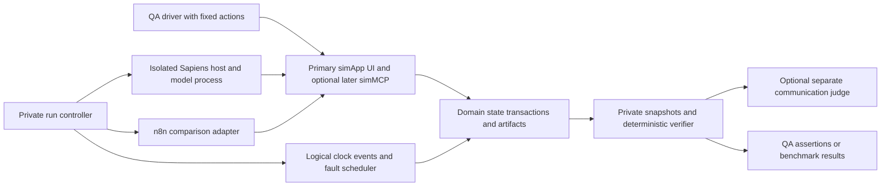

# Proposed Sapiens4 and AutoWFBench simulation architecture

**Confirmed architecture direction:** simApp-first for every selected application, even where APIs exist. A simApp supplies the full simulated UI needed by the selected workflow, over authoritative local state. simMCP is a later optional optimization when the application has adequate MCP capabilities; unavailable or limited MCP leaves the UI primary. API/CLI findings below document semantics and feasibility, not permission to substitute an API-first benchmark. See [decisions and roadmap](../decisions-and-roadmap.md).

Inspected 11 October 2026. Research and architecture only: no simulator, runner, Composer, integration or dependency changes were made. Both user-provided GitHub repositories were successfully cloned without installing dependencies or initializing the Blindly4 submodule.

| Repository | Inspected commit | Local checkout |
|---|---|---|
| AutoWFBench | `8e7cc5bb1002b103a2f63d73d3cd1d9de05c0552` | `work/repositories/AutoWFBench` under the current chat workspace |
| Sapiens4 | `71e93cb3de00183c263ec440919b313cf92ed8af` | `work/repositories/sapiens4` under the current chat workspace |

The source of workflow requirements is the saved Astra report containing ten personas and W01–W24. Provider capabilities and unknowns are in [application capability matrix](application-capability-matrix.md); proposed minimal behavior is in [simulation requirements](simulation-requirements.md).

## Existing AutoWFBench architecture

The current repository already separates core contracts/scoring, benchmark runtime, and execution interfaces. Preserve that dependency direction. Its `CONTRIBUTING.md` requires meaningful responsibilities and explicitly permits collections such as challenges, tests and documents to contain more than three leaves. This proposal follows that structure without inventing empty wrappers.

| Existing location | Verified source responsibility | Reuse and limitation |
|---|---|---|
| `autowfbench/core/contracts.py`, `common.py`, `scoring.py` | Challenge/schema validation, hashes, HTTP helpers, scoring | Reuse package provenance and validation. New business domains need new contract/check versions; preserve current score semantics |
| `benchmark/challenges/` | Two challenge packages: CRM lead qualification and production checkout recovery; definition/environment/scorecard files | CRM contains generic messaging/policy/research/CRM operations. Checkout contains incident/source/patch/test operations. Neither is a complete branded SaaS integration |
| `runtime/environment/apps.py` | Agent-visible operation docs and typed argument/result schemas | Natural boundary for registering selected operation contracts; avoid exposing private assertions or scenario fixtures |
| `runtime/environment/state.py` | ChallengeEnvironment, in-memory state, seed variants, receipt storage, tool-call events, fault injection, finalize checks | Reuse principles; replace challenge-wide branching gradually with domain modules. No general app database or multi-day event queue currently exists |
| `runtime/environment/server.py` | Authenticated GET /apps, POST /apps/{app}/{operation}, POST /tools; privileged POST /admin/finalize | Keep compatibility route. Add provider-specific facades only with explicit versions; separate admin transport in the proposed isolated deployment |
| `runtime/engine.py` | Run lifecycle, fresh environment process, public run context, polling/cancel, freeze evidence, redact logs, separate judging | Natural owner of fixture reset, event timeline and isolated candidate lifetime. Current process boundary is not a hostile-code sandbox |
| `interfaces/composer/search.py` | Codex graph generation/repair using public API docs and development previews; frozen candidate selection | Keep Composer as a comparison route. Do not insert customer-specific solution logic into app infrastructure |
| `interfaces/composer/graph.py` | Typed graph compilation to native n8n node boilerplate | Existing internal simApp HTTP contract, not a vendor connector compiler |
| `interfaces/composer/n8n.py` | n8n 2.42.3 validation/import/execute, run-context injection, fresh runtime storage, cancellation | Current allowlist includes manual trigger/code/HTTP/branch/merge nodes, not general webhook/Wait persistence. Do not assume it supports the proposed asynchronous workflows unchanged |
| `interfaces/solution.py` and solution/submission schemas | POST /runs -> execution_id; GET /runs/{id}; POST /runs/{id}/cancel; scripted fixture or supplied executor | Best integration boundary for a future Sapiens adapter; scripted reference is a fixture, not an intelligence result |
| `runtime/judge.py` | Independent Codex judge process operating on frozen evidence and private scorecard | Communication assessment can remain separate. Business success must come from authoritative simulation checks |

Source references: [AutoWFBench tree at inspected commit](https://github.com/aleski-green/AutoWFBench/tree/8e7cc5bb1002b103a2f63d73d3cd1d9de05c0552), [environment](https://github.com/aleski-green/AutoWFBench/blob/8e7cc5bb1002b103a2f63d73d3cd1d9de05c0552/autowfbench/runtime/environment/state.py), [engine](https://github.com/aleski-green/AutoWFBench/blob/8e7cc5bb1002b103a2f63d73d3cd1d9de05c0552/autowfbench/runtime/engine.py), [solution protocol](https://github.com/aleski-green/AutoWFBench/blob/8e7cc5bb1002b103a2f63d73d3cd1d9de05c0552/autowfbench/interfaces/solution.py).

### Current Codex Exec roles

Composer uses `CODEX_BIN` or discovered `codex`, calls `exec` with a pinned model, read-only sandbox, ephemeral session, tools/web disabled, a JSON schema and supplied public input. It compiles the resulting graph and evaluates development seeds 0, 2 and 4, retaining at most three candidate attempts in the default path. The README describes held-out seeds 6–11 with repeated evaluation; these are benchmark configuration choices, not a proven generalization guarantee.

The judge launches a separate ephemeral `codex exec` session with tools/web disabled and a response schema. It receives the frozen evidence/scorecard and records provenance. Model calls are nondeterministic and external; app state and deterministic checks should remain reproducible without those calls. No Codex execution or n8n runtime was launched during this architecture task.

[Composer source](https://github.com/aleski-green/AutoWFBench/blob/8e7cc5bb1002b103a2f63d73d3cd1d9de05c0552/autowfbench/interfaces/composer/search.py), [judge source](https://github.com/aleski-green/AutoWFBench/blob/8e7cc5bb1002b103a2f63d73d3cd1d9de05c0552/autowfbench/runtime/judge.py).

## Existing Sapiens4 architecture and integration gap

Sapiens4 is a local Python CORPORA host with SQLite UI/host persistence, per-Sapi conversation files and Notes/workspaces, Codex-backed turn execution, and native computer access through Blindly4. Platform code covers macOS and Windows. The Python responsibilities are `corpora/`, `runtime/`, and `computer/`; host code composes them. Do not introduce an AutoWFBench dependency into Sapiens runtime or core behavior.

| Location | Verified source behavior | Benchmark implication |
|---|---|---|
| `sapiens/corpora/host/cli.py`, `cli_transport.py`, `cli_render.py`; root `sapiens4` launcher | Local host CLI: chat, status, history, conversation watch/retry/cancel; machine JSON/JSONL outputs | Real CLI exists, but it is not already an AutoWFBench adapter. JSON/JSONL status is useful protocol evidence, not business success evidence |
| `sapiens/corpora/host/server.py` | Loopback HTTP host; same-origin/local JSON checks; agents/messages/state endpoints | Adapter can speak the existing host API on the same isolated machine/VM. It cannot simply point the CLI at an arbitrary remote URL |
| `sapiens/__main__.py` | Host accepts --data-dir and --port | Allocate a fresh data directory/port per independent case; never use the user's installed app state |
| `sapiens/corpora/host/service.py` | Host owns corpora.sqlite3 and per-Sapi workspace; supports factory_builder and pulse_clock injection | Existing test seams support QA with an injected model factory and pulse clock. They are not public CLI benchmark switches or a complete virtual-time integration |
| `sapiens/runtime/codex.py` | Fresh/resumed Codex session, JSONL activity parsing, deadline and process-tree cancellation | Session continuity can support persistence cases. Its normal command uses --dangerously-bypass-approvals-and-sandbox and inherits environment variables; outer isolation is mandatory |
| `sapiens/runtime/turns.py` | Prepared turns/context execution, cancellation, saved outcomes; optional execution callback | Existing internal testing seam; future adapter should preserve actual Sapiens behavior for intelligence trials |
| `sapiens/corpora/host/pulsation.py` | Injectible monotonic pulse admission clock | Useful QA seam; scheduling due dates elsewhere use utcnow, so this alone cannot advance all time-dependent behavior |
| `sapiens/corpora/host/routines.py`, service wiring | Scheduled routine persistence, minute-pulse dispatch, deterministic occurrence IDs, missed-interval coalescing, 1000-run cap | Contrary to stale README/CLI-spec text saying scheduling is inactive, current source wires ScheduledRoutines into Service and pulse dispatch. This was source-inspected, not runtime-tested. No general cron/task-graph claim follows |
| `sapiens/computer/`, `.gitmodules` | Native computer access dependency; Blindly4 submodule | UI benchmarking needs a disposable macOS/Windows desktop and controlled browser. Submodule was not initialized or built; functional UI availability remains untested |

Source references: [Sapiens tree](https://github.com/aleski-green/sapiens4/tree/71e93cb3de00183c263ec440919b313cf92ed8af), [CLI](https://github.com/aleski-green/sapiens4/blob/71e93cb3de00183c263ec440919b313cf92ed8af/sapiens/corpora/host/cli.py), [Codex runtime](https://github.com/aleski-green/sapiens4/blob/71e93cb3de00183c263ec440919b313cf92ed8af/sapiens/runtime/codex.py), [Service](https://github.com/aleski-green/sapiens4/blob/71e93cb3de00183c263ec440919b313cf92ed8af/sapiens/corpora/host/service.py), [routines](https://github.com/aleski-green/sapiens4/blob/71e93cb3de00183c263ec440919b313cf92ed8af/sapiens/corpora/host/routines.py).

Source searches found no implemented AutoWFBench bridge or business-app adapter registry in Sapiens. It recognizes MCP calls in provider events, but this does not prove a configured business MCP integration. The default agent interaction is the simulated application UI through Blindly4. A simMCP optimization may be added later only where the application supports adequate MCP capabilities and the configuration is isolated and pinned. The existing generic HTTP simApp interface is an internal/backend baseline, not the default agent workflow.

## Proposed modules and deployment boundaries

Keep three responsibilities: domain simulation, agent-facing transport, and run/evaluation control. Under AutoWFBench's existing tree, domain behavior belongs under runtime/environment, adapter-facing code under interfaces, and shared schema/provenance primitives under core. Provider collections can have as many real leaves as needed. The following diagram is a proposal, not the current deployment.

**Domain simulation:** Versioned schemas, transaction handlers and state transitions; SQLite is sufficient initially using the Python standard library. A run-local blob store holds actual attachments and exports. Persist event sequence and mutation receipts in the same transaction as business state. Domain modules cover messages, records/identity, files/ACLs, calendars, approvals, ledgers, commerce/service lifecycle and analytics. Do not build a complete CRM or Office suite.

**Agent-facing transport:** Build the complete accessible simApp UI for the selected workflow as the primary agent surface, even where vendor APIs exist. Retain existing HTTP discovery/compatibility routes for baseline compatibility and internal state operations. Those routes are not a substitute for UI execution. Later simMCP translates supported operations to the same state handlers as an optimization. Limited or absent MCP leaves the UI primary. Provider API documentation informs business/error semantics; implementing vendor REST/CLI facades is not a first-stage requirement. Document all fidelity limits.

**Run and evaluation control:** Engine provisions fixture state, run-scoped principals, event/fault schedule, candidate runtime, logical clock and snapshots. Evaluator computes private predicates over sealed authoritative state/events. Private future events, scorecards, fault trigger rules and admin credentials stay outside every candidate mount/network route. Hash fixtures/contracts/config and record model/repo/tool versions.

The same domain state handles every transport to prevent a UI from disagreeing with an API. Do not return evaluator success from a business operation; return genuine application state and validation errors. Domain handlers know business invariants, while case-specific grading predicates live in the private evaluator.

## Proposed Sapiens execution adapter

1. Accept AutoWFBench's existing POST /runs request and allocate a run-local Sapiens host, data directory, workspaces and browser profile inside an isolated candidate environment. Retain mapping from benchmark run ID to host/agent/turn/workload IDs.
2. Supply the natural business prompt and only the public environment catalog/base URL, run credential, authorized business files/policies and limits. Do not put the benchmark checkout, scorecard, initial private fixtures or final verification code in the agent's workspace.
3. Submit exactly once through Sapiens CLI machine JSON or the equivalent loopback host message endpoint. The CLI's accepted ID means acceptance, not completion. Store that ID before observing. An uncertain submission is reconciled using host history/state rather than automatically resent.
4. Let the actual agent choose business actions. Initially use the primary simApp UI through Blindly4; no orchestrator secretly solves the workflow. simMCP is an optional later optimization where supported, not an already implemented integration.
5. Poll existing conversation/workload status. Map Admin-input waiting to a runner-controlled clarification event, not immediate success/failure. For multi-event cases, keep the host/session/application state alive; inject subsequent authorized customer inputs and observe the same case until a business stopping condition or budget is reached.
6. Produce the existing submission envelope with final response and run-local artifacts. The authoritative simulator verifies business outcomes. CLI status and model traces support diagnosis and communication assessment only.
7. On cancel/deadline, invoke the existing eligible cancellation operation, stop the entire disposable process tree, revoke the run credential and freeze business effects. Ctrl-C of the CLI observer only detaches; it does not cancel Sapiens. An interrupted process may already have committed effects, so retries must inspect preserved state.

This bridge is proposed. Existing Sapiens CLI commands do not accept AutoWFBench run manifests, and no adapter or lifecycle code was implemented here.

## Deterministic time and persistent events

Use one logical UTC clock for app timestamps, due dates, rate buckets and event ordering, plus a real wall-clock watchdog for model/process limits. A private scheduler owns time advancement. The agent sees ordinary application clocks, next due records and messages; it cannot query the private event queue or jump to a favorable hidden future.

Current AutoWFBench uses now()/wall-clock metadata and seeded call-count faults; customer.ask synchronously supplies facts rather than waiting for actual future customer events. It needs a general event model for these workflows. Sapiens has pulse_clock injection but routine due calculations and conversation timestamps use utcnow. A future test-clock boundary must cover both clocks and restart state. Without that addition, label testing as event-driven replay with real host timing, not fully accelerated schedule evaluation.

Choose stable ordering `(logical_time, event_sequence)` for events. Independent API requests can execute concurrently, but mutations and event injection must serialize at explicit transaction boundaries. Seeded scenarios should vary data/decisions without using machine scheduling as a hidden random input. Resume cases preserve state/event cursor/receipts; independent cases reset all of them.

## Isolation design

Candidate environment gets only public app endpoints and an isolated Sapiens host. Private control and evaluation live outside it. Allow egress only for explicitly selected model inference/auth through a controlled gateway; deny live SaaS, production DNS/email, arbitrary remote MCP, redirects to external URLs and localhost services belonging to the user. CLI startup/discovery traffic also requires containment. The model endpoint remains external and nondeterministic; it is not customer-app execution.

Use an ephemeral OS user, container where runtime/platform permits, or disposable VM with scoped filesystem/network rules. For Blindly4 UI lanes, use a dedicated macOS/Windows VM or test machine/session; a native accessibility agent on the user's desktop is incompatible with isolated benchmarking. A fresh application directory alone is insufficient because normal Sapiens Codex runs are unrestricted and inherit process environment.

Provide model authentication separately from business credentials, and a clean tool/provider configuration rather than the user's ambient CLI config. No real user browser profiles, SaaS keys, personal home contents or evaluator mounts. Logs redact credentials; snapshots remain restricted. Freeze/revoke before scoring or cleanup to prevent late agent writes from changing the result.

## Two modes with shared infrastructure

| Aspect | QA automation in CI | Intelligence benchmarking |
|---|---|---|
| Driver | Fixed requests or injected Sapiens factory/executor for deterministic regression | Actual Sapiens prompt/planning/tool execution, pinned model/config |
| Purpose | Contract, state, reset, retry, permission and adapter correctness | Business understanding, planning, persistence and recovery |
| State/events | Same fixtures, handlers, scheduler and faults | Same infrastructure; held-out data and case variations |
| Oracle | Deterministic assertions; no model judge required | Same business predicates; optional separate communication judge |
| Expected reproducibility | Exact state/event transitions for fixed actions | Fixed environment and checks; repeated-trial outcome variability |
| Output | CI pass/fail and diffs, independent of intelligence score | Verified outcomes, completeness, safety/authority violations, efficiency, communication and variability |

Current scorer leaves the composite score null without a judge. QA should report deterministic checks directly rather than inventing a completed intelligence score or changing current scoring in this research task. QA scripted drivers are never presented as intelligent agents.

Keep generic simApp, provider API, MCP, CLI and native UI lanes separately labeled. Compare conventional scripted/n8n automation to Sapiens on the same business fixtures where practical; do not change interface richness or permissions between competitors without reporting the difference.

## Major risks and unknowns

- Real provider idempotency, pagination, ACLs, recurrence and error semantics can differ from a convenient simulator. Pin a minimal supported subset and publish fidelity/deviation notes.
- Current short, synchronous challenges do not prove multi-day persistence or recovery after host restarts. Event/time/lifecycle support is new proposed work.
- Sapiens normal process privileges, inherited configuration and native accessibility can reach real machine resources unless outer isolation blocks them.
- Documentation sometimes lags source, as scheduled routines demonstrate. Source inspection is not runtime validation; adapter behavior still requires a later isolated smoke test.
- Meta account/history/pricing, payroll/ATS/portal vendor identity, precise Canva editing and domain renewal write eligibility remain partial or unknown. Do not silently fill them with invented capabilities.
- Source-available licenses and redistribution/contract-copy terms should be reviewed before distribution; no license/merge authorization is assumed by writing this design.

## Recommended next steps

1. Review the inventory with the engineering lead and choose the smallest actual provider contracts for messages/files/registers/tasks. Keep observed Acuity/AdobeSign separate from illustrative alternatives.
2. Freeze the Google Drive simApp UI scope, internal domain contracts and fidelity limits. Keep Docs and Sheets in future file-model scope; resolve E items only for selected scenarios.
3. Design the private event/clock/permission/fault package and outcome predicates before writing adapters. Preserve current challenges and benchmark lock/version governance.
4. Specify the Sapiens adapter's submit/observe/clarify/cancel mapping and run-local host lifecycle, including ambiguous submission and restart cases.
5. After review and remaining captures, implement folder creation in My Drive with refresh persistence and private verification. Extend to Docs/Sheets file types and then broader workflows. Add simMCP later where supported and benchmark it separately from primary UI execution.

This package contains research and proposed architecture only. Original source inspection did not execute authenticated integrations. Later Drive discovery is documented separately; no simulator or benchmark implementation changes are included.
